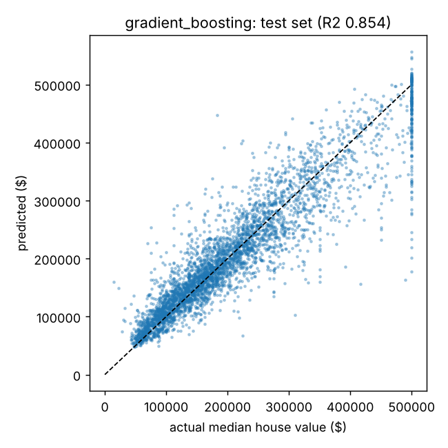
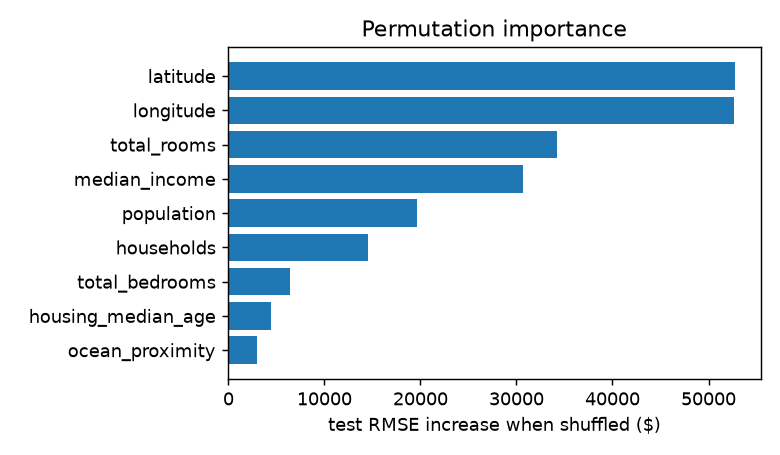
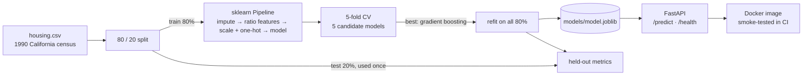

# house-price-ml

[](https://github.com/John-Ferd/house-price-ml/actions/workflows/ci.yml) 

Predicting the median house value of California districts from 1990 census data. The project compares five scikit-learn models with cross-validation, saves the best one, and serves it through a small FastAPI service that runs in Docker. CI checks every push.

> **Project history:** first built in 2025. In November 2026 it was rebuilt into a tested, reproducible package and published here, so the commit history starts then. All numbers in this README come from this published version.

## In one paragraph

Each row is one census block group: its location, the age of its houses, room and population counts, the median household income, and how close it is to the ocean. The target is the median house value in dollars. I engineered three per-household ratio features and put all preprocessing and the model into one scikit-learn `Pipeline`. Then I compared five models with 5-fold cross-validation on 80% of the data. Gradient boosting won, and on the held-out 20% it has **R² = 0.854** and **RMSE = $43,673**. The saved pipeline is served by a FastAPI endpoint that validates its input.

## Results

**5-fold cross-validation on the training 80%** (16,512 districts, `make train`):

| model | CV RMSE | CV MAE | CV R² |
|---|---|---|---|
| baseline (predict the mean) | $115,692 | $91,386 | 0.00 |
| linear regression | $68,239 | $49,204 | 0.652 |
| k-nearest neighbours (k = 10) | $59,991 | $40,392 | 0.731 |
| random forest (200 trees) | $50,287 | $32,783 | 0.811 |
| **gradient boosting** | **$46,472** | **$30,537** | **0.839** |

**Held-out test set** (4,128 districts, used once, for the chosen model only):

| metric | gradient boosting |
|---|---|
| R² | **0.854** |
| RMSE | $43,673 |
| MAE | $29,155 |
| median absolute % error | 11.3% |
| RMSE excluding districts at the $500,001 cap | $40,645 |

- Gradient boosting cuts CV RMSE by **60%** compared with always predicting the mean.
- The test score is close to the CV score, so the CV estimate wasn't optimistic.
- The tree models beat linear regression by a wide margin because price depends on location in a non-linear way: coastal vs inland, the Bay Area vs Los Angeles. A straight line in latitude and longitude can't capture that.

<p align="center"> </p>

**What the model relies on** (permutation importance: how much test RMSE goes up when one column is shuffled):
1. latitude (+$55k)
2. longitude (+$51k)
3. median income (+$38k)

Location and income dominate, which matches intuition about housing prices.

**The vertical stripe at $500,000** in the left plot is a data quirk. The census top-coded values at $500,001, so for 4.4% of test districts the true value is "$500,001 or more" and no model can know the real number. I kept those rows in the test set, because dropping them would make the numbers look better than they really are, and reported RMSE without them separately (above).

## Architecture



## How it works

**Features (`features.py`).** Raw counts like `total_rooms` and `population` mostly measure how *big* a district is, not what its houses are like. So I add:
- `rooms_per_household`
- `bedrooms_per_room`
- `population_per_household`

Missing `total_bedrooms` values (about 1% of rows) are filled with the median. Numeric columns are standardized, and `ocean_proximity` is one-hot encoded.

**Why one Pipeline.** Preprocessing and model are a single scikit-learn `Pipeline`. That has two consequences:
1. Inside cross-validation, the imputer's median and the scaler's mean and standard deviation are learned on the training folds only. Computing them on all the data first would leak information from the validation fold.
2. The saved file `models/model.joblib` contains every step. The API calls `model.predict(raw_rows)` and can't apply a different transform than training did.

**Model selection.** I split off 20% as a test set first and didn't look at it until the end. I picked the model by CV RMSE on the other 80%, refit it on all of the 80%, and scored it once on the test set. Picking the model by its test score would turn the test set into part of training.

**Gradient boosting vs random forest.** Both combine many decision trees:
- A random forest grows trees independently on bootstrap samples and averages them, which mainly reduces variance.
- Gradient boosting adds small trees one at a time, each one fit to the errors the current ensemble still makes, which mainly reduces bias.

On this data boosting was better and also about 9× faster to train in my run (1.5 s vs 12.9 s; scikit-learn's histogram-based version).

## The API

```bash
make serve                 # http://localhost:8000/docs has an interactive page
curl -X POST localhost:8000/predict -H 'Content-Type: application/json' -d '{
  "instances": [{"longitude": -122.23, "latitude": 37.88, "housing_median_age": 41,
                 "total_rooms": 880, "total_bedrooms": 129, "population": 322,
                 "households": 126, "median_income": 8.3252, "ocean_proximity": "NEAR BAY"}]}'
# {"predictions":[450615.24],"model":"gradient_boosting"}
```

- `GET /health` reports whether the model is loaded and returns its test metrics.
- `POST /predict` takes a list of districts (1 to 1,000) and returns one price each.
- Inputs are checked by pydantic: a missing field, a wrong type, or an unknown `ocean_proximity` value gets HTTP 422 before it reaches the model.
- `total_bedrooms` may be `null`; the pipeline imputes it.
- `median_income` is in tens of thousands of dollars, as in the census data.

The example district is the first row of the dataset (true value $452,600). It was in the training data, so the close prediction is a sanity check, not evidence of accuracy. The test-set numbers above are the real measure.

**Docker.** `make docker` builds a `python:3.11-slim` image containing the package and the trained model, and serves it on port 8000. CI runs a smoke test on every push: it builds the image, starts it, and calls `/health` and `/predict`.

## Tests

`make test` runs 10 tests:
- Ratio features are computed correctly.
- The preprocessor handles missing values and unseen categories.
- The imputer learns from the training data only.
- Every model beats the mean baseline.
- The pipeline goes from raw rows to prices.
- API: health check, predictions, rejection of bad input (422), and a missing model file (503).

CI (`.github/workflows/ci.yml`) runs lint and tests, then the Docker smoke test.

## How to run

```bash
pip install -e ".[dev]"    # or: make setup
make data                  # downloads housing.csv (1.4 MB) into data/
make train                 # ~1 minute: CV table, test metrics, models/model.joblib, plots
make test
make serve                 # or: make docker
```

The trained model is committed (`models/model.joblib`, 1.5 MB), so the API and Docker image work without retraining. It was saved with scikit-learn 1.9.1, which `pyproject.toml` pins, because a pickled model may not load under a different scikit-learn version. `make train` rebuilds it.

## Layout

```
src/house_price/
├── data.py        # loading, column lists, synthetic data for tests
├── features.py    # ratio features + preprocessing pipeline
├── models.py      # the five candidate models
└── api.py         # FastAPI service
scripts/train.py   # cross-validation, final fit, test metrics, plots
tests/             # 10 tests
Dockerfile · Makefile · .github/workflows/ci.yml
```

## Limitations

- The data is from 1990 and is at district level, so it can't price an individual house today.
- The random train/test split lets the model see neighbouring districts of every test district. A split that holds out whole regions would give a harsher, more realistic error for an area the model has never seen.
- Hyperparameters were set once to reasonable values, not tuned.
- Prices above $500,001 can't be learned because of the census cap.

Data: California Housing (1990 U.S. Census), the version with raw counts and `ocean_proximity` from Aurélien Géron's *Hands-On Machine Learning* repository.
