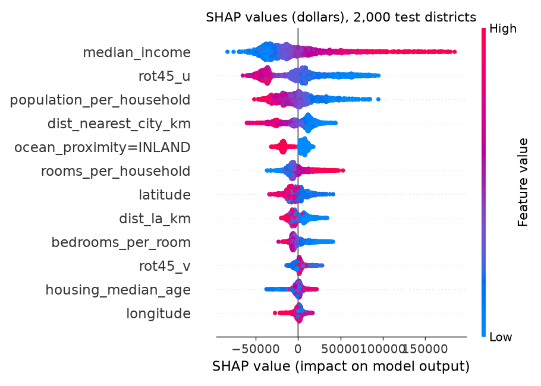
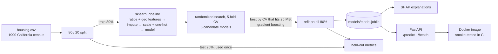

# house-price-ml

[](https://github.com/John-Ferd/house-price-ml/actions/workflows/ci.yml) 

Predicting the median house value of California districts from 1990 census data. The project tunes and compares six scikit-learn models with cross-validation, explains the chosen model with SHAP, and serves it through a small FastAPI service that runs in Docker. CI checks every push.

> **Project history:** first built in 2025. In November 2026 it was rebuilt into a tested, reproducible package and published here, so the commit history starts then. All numbers in this README come from this published version.

## In one paragraph

Each row is one census block group: its location, the age of its houses, room and population counts, the median household income, and how close it is to the ocean. The target is the median house value in dollars. I engineered per-household ratios and location features (distance to the San Francisco and Los Angeles job centres, and rotated coordinates), and put all preprocessing and the model into one scikit-learn `Pipeline`. Every model with hyperparameters was tuned by randomized search with 5-fold cross-validation on 80% of the data, and the winner was chosen by CV alone. On the held-out 20%, the tuned gradient-boosting model has **R² = 0.869** and **RMSE = $41,300**. The saved pipeline is served by a FastAPI endpoint that validates its input.

## Results

**5-fold cross-validation on the training 80%** (16,512 districts, `make train`; each tunable model at its best of 30 random settings):

| model | CV RMSE | CV MAE | CV R² |
|---|---|---|---|
| baseline (predict the mean) | $115,692 | $91,386 | 0.00 |
| linear regression | $67,246 | $48,456 | 0.662 |
| k-nearest neighbours (tuned: k = 11, distance-weighted) | $56,686 | $37,344 | 0.760 |
| random forest (tuned) | $43,759 | $28,043 | 0.857 |
| **gradient boosting (tuned)** | **$44,125** | $28,275 | 0.854 |
| gradient boosting on log(price) (tuned) | $44,815 | $27,830 | 0.850 |

**Which model is served.** The tuned random forest had the best CV RMSE by $366, less than one fold's standard deviation ($426). But its saved file is 94 MB even compressed, and the model is committed to this repo and baked into the Docker image. So model selection has a deployment constraint: the served model must fit in 25 MB. The training script skips any model over budget and takes the next best by CV, which is gradient boosting (1.6 MB). The skip is recorded in `artifacts/metrics.json`.

**Held-out test set** (4,128 districts, used once, for the served model only):

| metric | tuned gradient boosting | previous untuned version |
|---|---|---|
| R² | **0.869** | 0.854 |
| RMSE | **$41,300** | $43,673 |
| MAE | **$26,874** | $29,155 |
| median absolute % error | **10.0%** | 11.3% |
| RMSE excluding districts at the $500,001 cap | **$38,414** | $40,645 |

- Gradient boosting cuts CV RMSE by **62%** compared with always predicting the mean.
- Tuning plus the location features lowered test RMSE by **5.4%** relative to the earlier, untuned version of this repo.
- The test score is close to the CV score, so the CV estimate wasn't optimistic.
- Transparency note: while building this version, the random forest was first trained and scored on the test set before the size rule existed. Its test R² (0.866) was slightly *below* the served model's, so the size rule did not make the reported number look better.
- The tree models beat linear regression by a wide margin because price depends on location in a non-linear way: coastal vs inland, the Bay Area vs Los Angeles.

<p align="center"> </p>

**What the model relies on.** SHAP values (`make explain`) give, for every district, how much each feature moved its prediction away from the average. Averaged over 2,000 test districts (mean |SHAP| in dollars):
1. median income ($32k)
2. rotated coordinate lat + lon ($27k), which tracks the coast-to-inland direction
3. people per household ($18k)
4. distance to the nearest of SF and LA ($15k)
5. inland vs not ($11k)

The engineered location features carry much of what raw latitude and longitude carried before. A permutation-importance check on the raw input columns (`artifacts/importance.png`) agrees that location and income dominate.

**The vertical stripe at $500,000** in the left plot is a data quirk. The census top-coded values at $500,001, so for 4.4% of test districts the true value is "$500,001 or more" and no model can know the real number. I kept those rows in the test set, because dropping them would make the numbers look better than they really are, and reported RMSE without them separately (above).

## Architecture



## How it works

**Features (`features.py`).** Raw counts like `total_rooms` and `population` mostly measure how *big* a district is, not what its houses are like. So I add:
- `rooms_per_household`, `bedrooms_per_room`, `population_per_household`;
- great-circle (haversine) distance to San Francisco, to Los Angeles, and to the nearer of the two;
- latitude and longitude rotated by 45°. Trees split on one axis at a time, so a diagonal boundary such as the coastline takes many splits in (lat, lon) but fewer on rotated axes.

All of these are fixed formulas with nothing learned from data, so they cannot leak. Missing `total_bedrooms` values (about 1% of rows) are filled with the median. Numeric columns are standardized, and `ocean_proximity` is one-hot encoded.

**Why one Pipeline.** Preprocessing and model are a single scikit-learn `Pipeline`. That has two consequences:
1. Inside cross-validation, the imputer's median and the scaler's mean and standard deviation are learned on the training folds only. Computing them on all the data first would leak information from the validation fold.
2. The saved file `models/model.joblib` contains every step. The API calls `model.predict(raw_rows)` and can't apply a different transform than training did.

**Tuning and model selection.** I split off 20% as a test set first and didn't look at it until the end. For each model with hyperparameters, `RandomizedSearchCV` tries 30 random settings (learning rate, number and size of trees, leaf size, L2 penalty, feature subsampling for boosting; feature fraction and leaf size for the forest; k for k-NN), each scored by 5-fold CV on the other 80%. Models are compared by the CV RMSE of their best setting, and the served one is refit on all of the 80% and scored once on the test set. Picking the model or its settings by test score would turn the test set into part of training.

**Raw vs log target.** House prices are right-skewed, so I also tried boosting on log(price) and exponentiating back. It had the best MAE but a slightly worse RMSE: training on logs weights relative errors equally, while RMSE is dominated by the expensive districts.

## The API

```bash
make serve                 # http://localhost:8000/docs has an interactive page
curl -X POST localhost:8000/predict -H 'Content-Type: application/json' -d '{
  "instances": [{"longitude": -122.23, "latitude": 37.88, "housing_median_age": 41,
                 "total_rooms": 880, "total_bedrooms": 129, "population": 322,
                 "households": 126, "median_income": 8.3252, "ocean_proximity": "NEAR BAY"}]}'
```

- `GET /health` reports whether the model is loaded and returns its test metrics.
- `POST /predict` takes a list of districts (1 to 1,000) and returns one price each.
- Inputs are checked by pydantic: a missing field, a wrong type, or an unknown `ocean_proximity` value gets HTTP 422 before it reaches the model.
- `total_bedrooms` may be `null`; the pipeline imputes it.
- `median_income` is in tens of thousands of dollars, as in the census data.

The example district is the first row of the dataset (true value $452,600). It was in the training data, so a close prediction is a sanity check, not evidence of accuracy. The test-set numbers above are the real measure.

**Docker.** `make docker` builds a `python:3.11-slim` image containing the package and the trained model, and serves it on port 8000. CI runs a smoke test on every push: it builds the image, starts it, and calls `/health` and `/predict`.

## Tests

`make test` runs 14 tests:
- Ratio features are computed correctly; haversine distances are right (SF to LA ≈ 559 km); location features are finite.
- The preprocessor handles missing values and unseen categories, and the imputer learns from the training data only.
- Every model, including the log-target one, beats the mean baseline, and the log-target model predicts in dollars.
- Every hyperparameter in the search spaces is a real parameter of the pipeline.
- The pipeline goes from raw rows to prices.
- API: health check, predictions, rejection of bad input (422), and a missing model file (503).

The unit tests run on a small synthetic frame with the real schema, so CI needs no download. All reported results use the real census data.

CI (`.github/workflows/ci.yml`) runs lint and tests, a quick end-to-end training run, then the Docker smoke test.

## How to run

```bash
pip install -e ".[dev]"    # or: make setup
make data                  # downloads housing.csv (1.4 MB) into data/
make train                 # tunes and compares 6 models (several minutes on a multi-core machine)
pip install -e ".[explain]" && make explain   # SHAP summary plot and importances
make test
make serve                 # or: make docker
```

The trained model is committed (`models/model.joblib`, 1.6 MB), so the API and Docker image work without retraining. It was saved with scikit-learn 1.9.1, which `pyproject.toml` pins, because a pickled model may not load under a different scikit-learn version. `make train` rebuilds it.

## Layout

```
src/house_price/
├── data.py        # loading, column lists, synthetic data for tests
├── features.py    # ratio + location features, preprocessing pipeline
├── models.py      # the six candidate models and their search spaces
└── api.py         # FastAPI service
scripts/train.py   # tuning, model selection, final fit, test metrics, plots
scripts/explain.py # SHAP values for the saved model
tests/             # 14 tests
Dockerfile · Makefile · .github/workflows/ci.yml
```

## Limitations

- The data is from 1990 and is at district level, so it can't price an individual house today.
- The random train/test split lets the model see neighbouring districts of every test district. A split that holds out whole regions would give a harsher, more realistic error for an area the model has never seen.
- The CV score of a tuned model is slightly optimistic (it is the best of 30 settings); the single test-set score is the unbiased number.
- Prices above $500,001 can't be learned because of the census cap.

Data: California Housing (1990 U.S. Census), the version with raw counts and `ocean_proximity` from Aurélien Géron's *Hands-On Machine Learning* repository.
